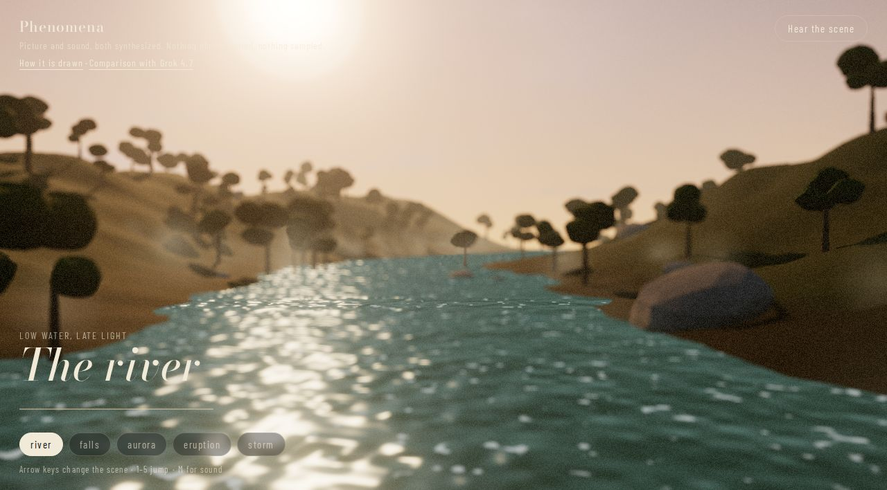
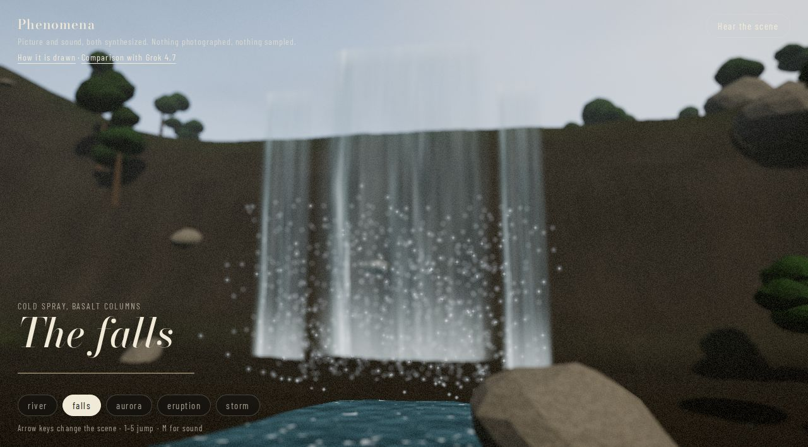
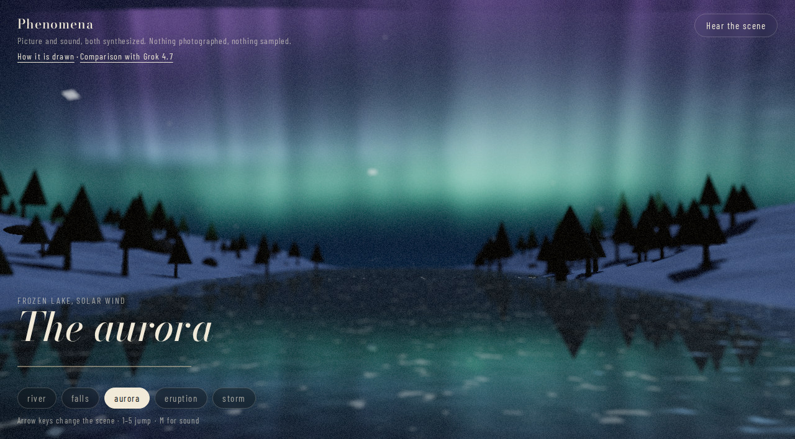
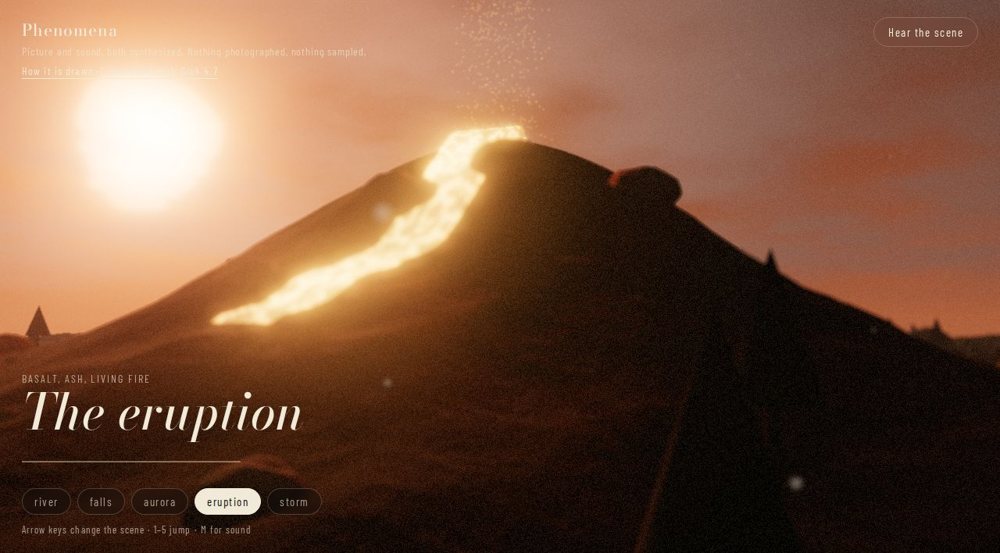
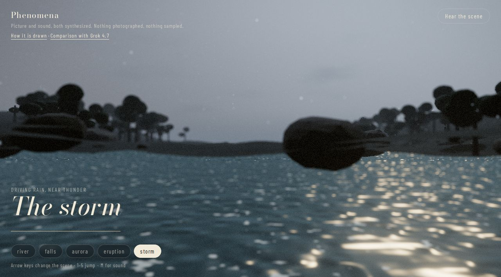
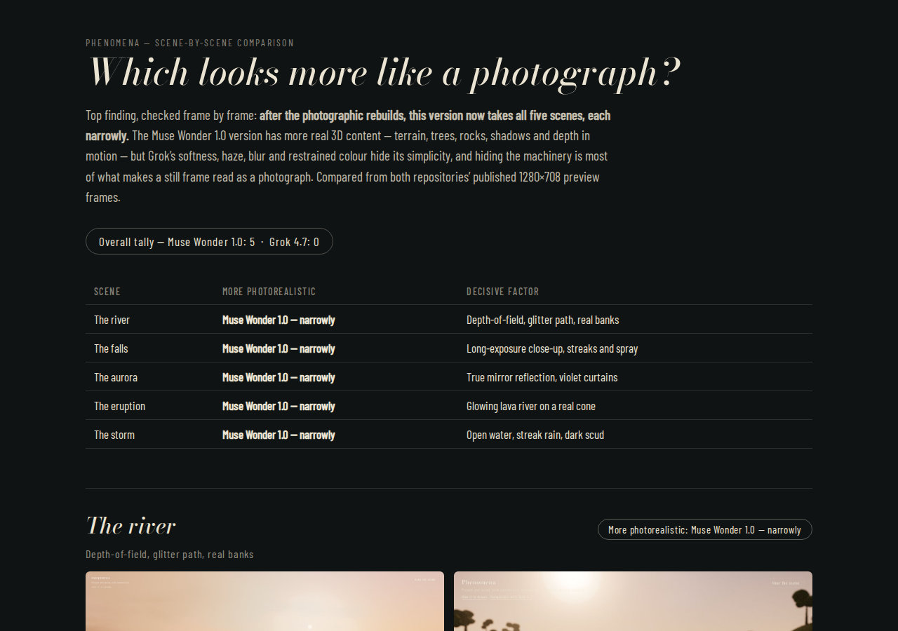
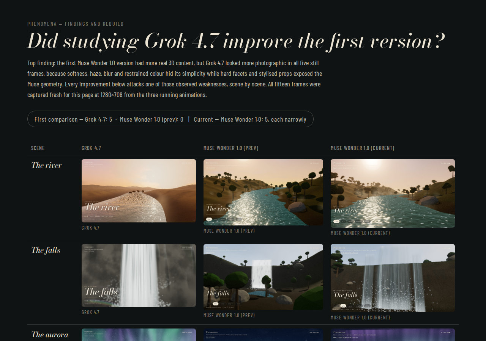

# Phenomena

Natural scenes drawn in the browser, with the sound synthesized as they play.

## Live

Click a frame to open that scene. [How it is drawn](https://az9713.github.io/muse-wonder-1.0-nature-simulation/journey.html) explains the code.

<table>
  <tr>
    <td align="center">
      <a href="https://az9713.github.io/muse-wonder-1.0-nature-simulation/?scene=river"></a><br>
      <a href="https://az9713.github.io/muse-wonder-1.0-nature-simulation/?scene=river">The river</a>
    </td>
    <td align="center">
      <a href="https://az9713.github.io/muse-wonder-1.0-nature-simulation/?scene=falls"></a><br>
      <a href="https://az9713.github.io/muse-wonder-1.0-nature-simulation/?scene=falls">The falls</a>
    </td>
  </tr>
  <tr>
    <td align="center">
      <a href="https://az9713.github.io/muse-wonder-1.0-nature-simulation/?scene=aurora"></a><br>
      <a href="https://az9713.github.io/muse-wonder-1.0-nature-simulation/?scene=aurora">The aurora</a>
    </td>
    <td align="center">
      <a href="https://az9713.github.io/muse-wonder-1.0-nature-simulation/?scene=eruption"></a><br>
      <a href="https://az9713.github.io/muse-wonder-1.0-nature-simulation/?scene=eruption">The eruption</a>
    </td>
  </tr>
  <tr>
    <td align="center" colspan="2">
      <a href="https://az9713.github.io/muse-wonder-1.0-nature-simulation/?scene=storm"></a><br>
      <a href="https://az9713.github.io/muse-wonder-1.0-nature-simulation/?scene=storm">The storm</a>
    </td>
  </tr>
</table>

Click **Hear the scene** on the player. Browsers block synthesized audio until that gesture.

## Comparison

Click the frame to open the live comparison with Grok 4.7, scene by scene.

<a href="https://az9713.github.io/muse-wonder-1.0-nature-simulation/comparison.html"></a><br>
<a href="https://az9713.github.io/muse-wonder-1.0-nature-simulation/comparison.html">Which looks more like a photograph?</a>

## Findings

Click the frame to open the three-way findings page: Grok 4.7, the first Muse Wonder 1.0 version, and the current version, scene by scene, with what was learned from Grok and what was changed because of it.

<a href="https://az9713.github.io/muse-wonder-1.0-nature-simulation/findings.html"></a><br>
<a href="https://az9713.github.io/muse-wonder-1.0-nature-simulation/findings.html">Did studying Grok 4.7 improve the first version?</a>

## Run it locally

```bash
npm install
npm run dev
```

The dev server prints a local URL. Production uses a different base path, `/muse-wonder-1.0-nature-simulation/`, which the Pages workflow sets when it builds.

## Stack

Three.js and custom GLSL for the picture. The Web Audio API for the sound. Vite builds the four pages, `index.html`, `journey.html`, `comparison.html` and `findings.html`.
